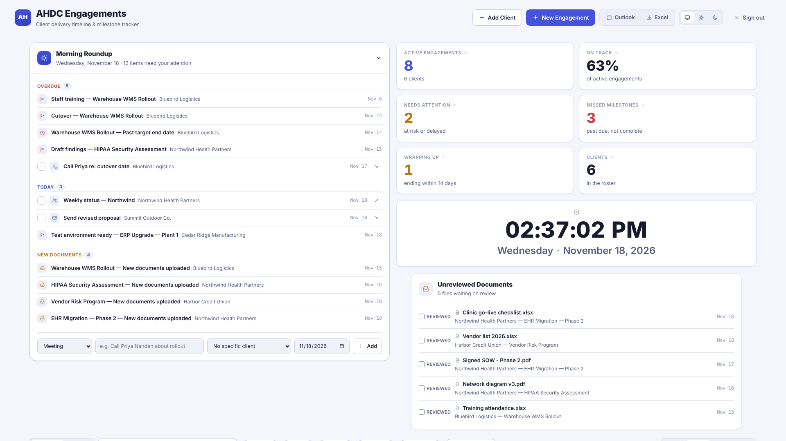
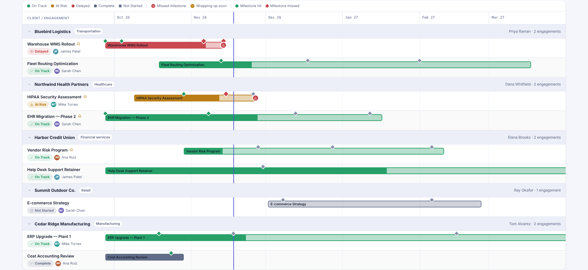
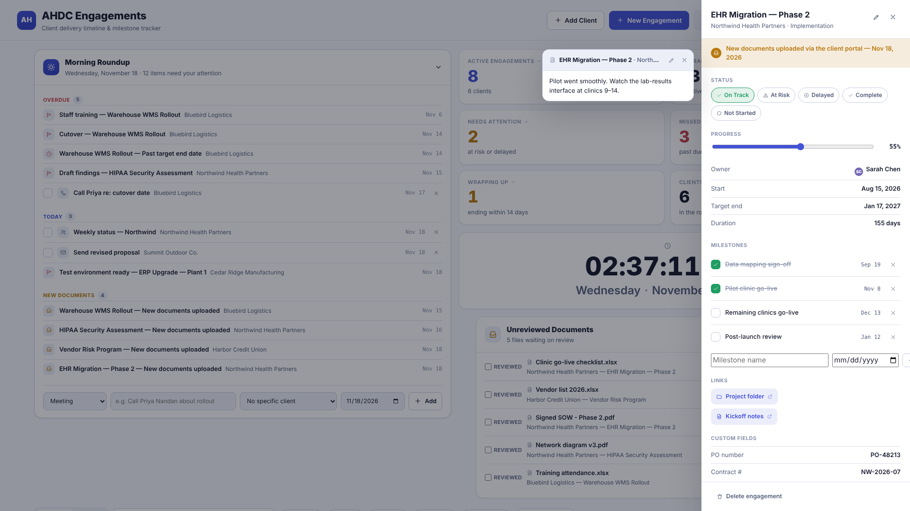
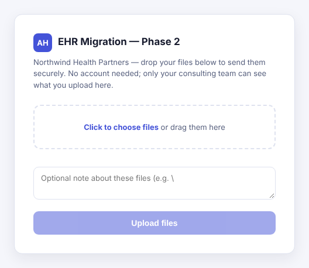
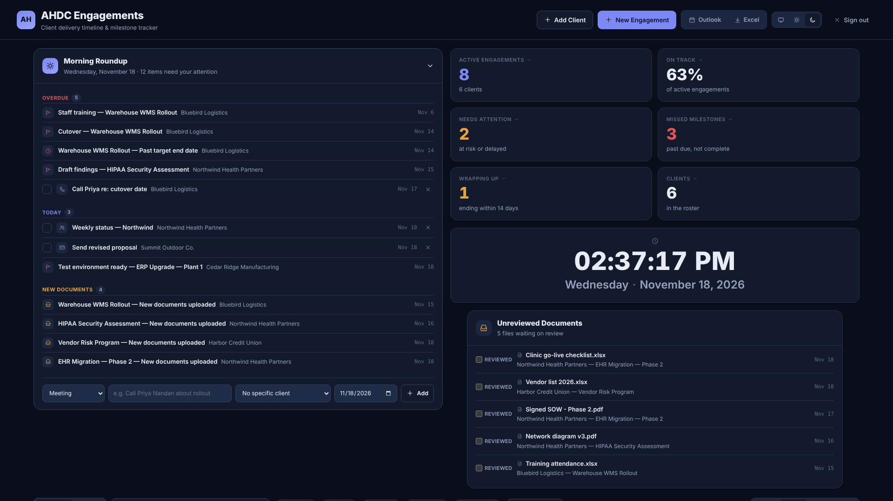

# AHDC Engagements Dashboard

A self-hosted, wall-display-friendly dashboard for tracking client engagements: a Gantt-style timeline, a client roster, a daily "Morning Roundup" of what needs attention, KPI tiles, and a **built-in client upload portal** so clients can send documents straight to the server, no account needed.



> All names and data in the screenshots are fictional demo data.

## Documentation

- **[User Guide](docs/USER-GUIDE.md)** covers every panel, button and workflow, with screenshots.
- **[Deployment & administration](docs/DEPLOYMENT.md)** covers installing on a VPS, updating, backups, changing the password and troubleshooting.

## Features

| | |
|---|---|
| **Timeline** | Clients grouped with Gantt bars, milestone diamonds, a "today" line, progress fill, 3/6/12-month/All zoom, hover tooltips |
| **Roster** | Every client with contacts (click to email or call), secure file link, and engagements |
| **Morning Roundup** | Overdue items, today's items, new client documents and at-risk work, plus a quick-add for meetings, calls, emails and trips |
| **KPI tiles** | Active, % on track, needs attention, missed milestones, wrapping up, clients; click a tile to see what's behind the number |
| **Engagement drawer** | Status, progress slider, milestones, links, custom fields, notes, upload portal and file review |
| **Client upload portal** | One private link per engagement; uploads are flagged on the dashboard the moment they arrive |
| **Unreviewed Documents** | Every client-uploaded file not yet checked off, across all engagements |
| **Custom fields** | Unlimited name/value pairs per engagement (PO #, contract #, …), searchable |
| **Exports** | Milestones to an Outlook calendar CSV, and everything to an Excel CSV |
| **Themes** | Light, dark or match-system |
| **Big clock** | Readable from across the room |

<p>
 
 
</p>

## Try it locally with demo data

Requires **Node.js 18+**.

```bash
git clone https://github.com/rickkollins/AHDC-Dashboard.git
cd AHDC-Dashboard
npm install
cp .env.example .env
node scripts/hash-password.js "demo-password"      # paste the ADMIN_PASSWORD_HASH=... line into .env
node -e "console.log(require('crypto').randomBytes(48).toString('hex'))"   # paste into SESSION_SECRET in .env
# in .env also set:  COOKIE_SECURE=false   (needed for plain http://localhost)
node scripts/make-demo-data.js                     # fictional clients/engagements + sample uploads
npm start
```

Open **http://localhost:3000** and sign in with `demo-password`.

> ⚠️ Never run `make-demo-data.js` on the live server: it replaces `data/data.json`.

## Project layout

```
server.js                  Express backend: login, data API, upload portal, file downloads
public/index.html          Dashboard page + styles
public/app.js              Dashboard UI (timeline, roster, drawer, forms, exports)
public/login.html          Sign-in page
public/portal.html         Client-facing upload page
scripts/hash-password.js   Generates ADMIN_PASSWORD_HASH for .env
scripts/make-demo-data.js  Generates fictional demo data
.env.example               Template for settings and secrets (.env itself is never committed)
docs/                      User guide, deployment notes, screenshots
data/, uploads/            Created at runtime; hold real client data and are ignored by Git
```

## A note on scale

This is built for what it is: one consulting firm's internal tracker with a handful of staff and clients. Data is a single JSON file and uploads go straight to local disk. That keeps it simple, and it will comfortably handle years of use at that scale. It isn't designed as a multi-tenant product.
