# AHDC Engagements Dashboard — User Guide

This guide walks through every part of the dashboard: what each panel shows, what every button does, and how to do the everyday tasks (adding a client, starting an engagement, collecting documents from a client, and so on).

> **About the screenshots:** every company, person, email and phone number shown here is fictional demo data created by `scripts/make-demo-data.js`. Your own dashboard will show your real clients in the same layout.

---

## Contents

1. [Signing in and out](#1-signing-in-and-out)
2. [The screen at a glance](#2-the-screen-at-a-glance)
3. [The header bar](#3-the-header-bar)
4. [Morning Roundup](#4-morning-roundup)
5. [KPI tiles](#5-kpi-tiles)
6. [Clock](#6-clock)
7. [Unreviewed Documents](#7-unreviewed-documents)
8. [Toolbar: views, search, filters, zoom](#8-toolbar-views-search-filters-zoom)
9. [Timeline view](#9-timeline-view)
10. [Roster view](#10-roster-view)
11. [The engagement drawer](#11-the-engagement-drawer)
12. [The floating notes window](#12-the-floating-notes-window)
13. [Adding and editing a client](#13-adding-and-editing-a-client)
14. [Adding and editing an engagement](#14-adding-and-editing-an-engagement)
15. [The client upload portal (what your client sees)](#15-the-client-upload-portal-what-your-client-sees)
16. [Exporting to Outlook and Excel](#16-exporting-to-outlook-and-excel)
17. [Light, dark and system themes](#17-light-dark-and-system-themes)
18. [Deleting things](#18-deleting-things)
19. [Keyboard shortcuts and small tips](#19-keyboard-shortcuts-and-small-tips)
20. [How statuses, colors and alerts are decided](#20-how-statuses-colors-and-alerts-are-decided)
21. [Troubleshooting](#21-troubleshooting)

---

## 1. Signing in and out

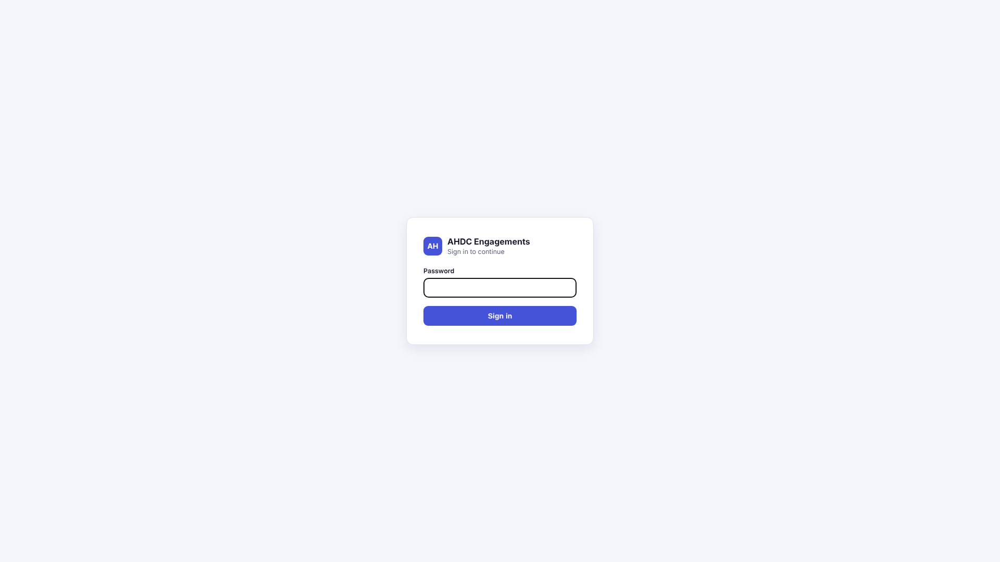

- Go to your dashboard's address (for the AHDC install: **https://3dprintingnews.fun**). If you're not signed in, you're sent to the **Sign in** page automatically.
- Type the **team password** and press **Enter** or click **Sign in**. There's one shared password for the whole team — there are no individual user accounts.
- You stay signed in on that browser for **14 days**, then you'll be asked for the password again.
- To sign out, click **Sign out** (the **×** at the far right of the header).
- After **20 wrong passwords in 15 minutes** from the same connection, sign-in is temporarily blocked. Wait 15 minutes and try again.
- Forgot the password or want to change it? See [Changing the team password](DEPLOYMENT.md#changing-the-team-password).

---

## 2. The screen at a glance

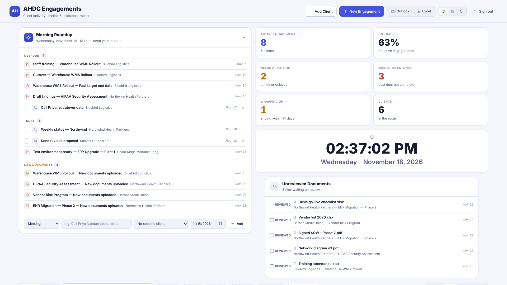

The dashboard is one page, laid out top to bottom:

| Area | Where | What it's for |
|---|---|---|
| **Header bar** | Very top | Add clients/engagements, export, switch theme, sign out |
| **Morning Roundup** | Top-left | Everything that needs attention today, plus a quick-add for to-dos |
| **KPI tiles** | Top-right | Six headline numbers; click one to see what's behind it |
| **Clock** | Right, under the KPIs | Large live time and date, readable from across a room |
| **Unreviewed Documents** | Right, under the clock | Every client-uploaded file nobody has checked off yet |
| **Toolbar** | Middle | Switch Timeline/Roster, search, filter by status/owner, zoom |
| **Timeline or Roster** | Bottom | The main view of all clients and engagements |

Here's the full page scrolled all the way down:

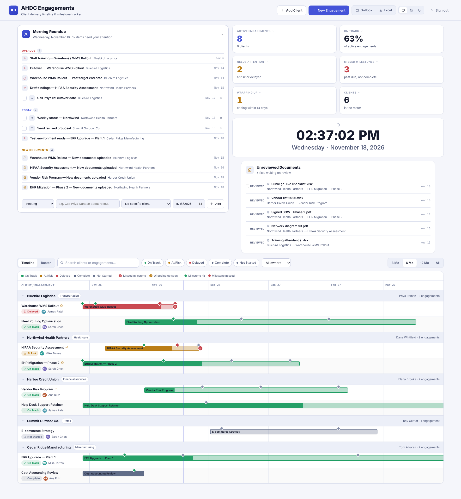

On a wide screen (like a wall-mounted 4K display), the Roundup and the right-hand column sit side by side. On a narrow window they stack vertically.

**Everything saves automatically.** There's no Save button for the dashboard as a whole — every checkbox, status change, or edit is sent to the server the moment you make it. If a save fails, a small message appears at the bottom of the screen ("Could not save that change…").

> **Terminology:** the app calls each piece of client work an **engagement**. (Some people on the team call them "instances" — same thing.)

---

## 3. The header bar

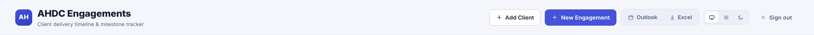

From left to right:

| Control | What it does |
|---|---|
| **AH / AHDC Engagements** | Just the title. |
| **+ Add Client** | Opens the [Add client](#13-adding-and-editing-a-client) form. |
| **+ New Engagement** | Opens the [New engagement](#14-adding-and-editing-an-engagement) form. You need at least one client first. |
| **Outlook** | Downloads every milestone as a CSV file that Outlook's calendar can import. See [Exporting](#16-exporting-to-outlook-and-excel). |
| **Excel** | Downloads one big CSV of every client, contact and engagement for Excel. |
| **Monitor / Sun / Moon icons** | Theme: match your computer's setting / always light / always dark. See [Themes](#17-light-dark-and-system-themes). |
| **× Sign out** | Signs this browser out. |

---

## 4. Morning Roundup

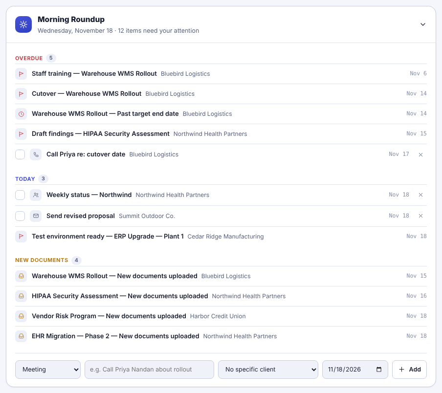

The Roundup is the "what do I need to deal with today" list. The header shows today's date and how many items need attention. Click the **⌄ arrow** at the top-right to collapse or expand the panel.

Items are sorted into sections, and each section is ordered by date (oldest first):

| Section | What shows up here |
|---|---|
| **Overdue** (red) | Milestones whose date has passed and aren't checked off · your own to-do items whose date has passed · engagements past their target end date that aren't marked Complete |
| **Today** (blue) | Milestones and to-do items dated today |
| **New documents** (amber) | Engagements where a client has uploaded files through the portal and nobody has clicked **Mark reviewed** yet |
| **Needs attention** | Engagements marked **At Risk** or **Delayed**, or ending within the next **14 days** — unless they already appear above |

Each row shows an icon for the type of item (flag = milestone, clock = past end date, inbox = new documents, phone/people/envelope/plane = to-do type), the item name, the engagement, the client, and the date.

- **Click any row** about an engagement, milestone or document to open that [engagement's drawer](#11-the-engagement-drawer).
- To-do items have a **checkbox** on the left (click to mark done — it disappears from the list) and an **×** on the right (deletes it).

### Adding a to-do (quick-add)

The row at the bottom of the Roundup adds a personal to-do — a meeting, call, email follow-up or trip:

1. Pick the type in the first drop-down: **Meeting**, **Call**, **Email follow-up** or **Trip**.
2. Type what it is in the text box, e.g. *Call Priya about the cutover date*.
3. Optionally pick the client it relates to (or leave **No specific client**).
4. Pick the date (defaults to today).
5. Click **+ Add** (or press Enter).

It appears in **Today** or **Overdue** when its day comes. To-dos dated in the future don't show until their date arrives.

---

## 5. KPI tiles

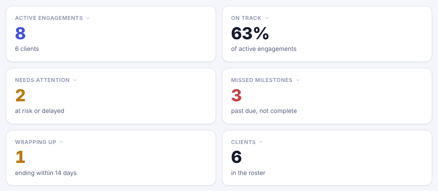

Six headline numbers, recalculated instantly whenever anything changes:

| Tile | Counts |
|---|---|
| **Active engagements** | Every engagement not marked Complete (subtitle shows how many clients you have) |
| **On track** | What percentage of active engagements are marked On Track |
| **Needs attention** | Active engagements marked At Risk or Delayed |
| **Missed milestones** | Milestones whose date has passed and aren't checked off |
| **Wrapping up** | Active engagements whose target end date is within the next 14 days |
| **Clients** | Number of clients in the roster |

**Click any tile** (there's a small ⌄ next to each label) to drop down the list of exactly which engagements, milestones or clients make up that number. Click a row in that list to jump straight to it — an engagement or milestone opens its drawer, a client opens its edit form. Click the tile again (or anywhere else) to close the list.

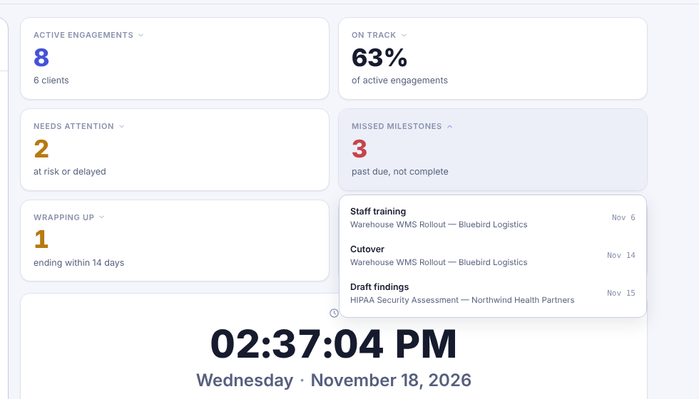

---

## 6. Clock

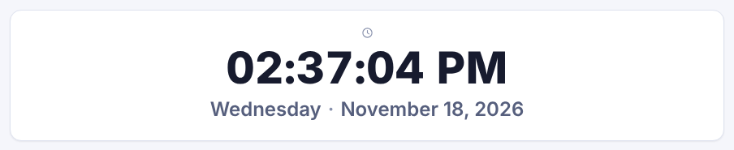

A large live clock (updates every second) with the day of the week and the date, sized to be read from across the room on a wall display. It uses the time zone of the computer showing the dashboard. Nothing to click.

---

## 7. Unreviewed Documents

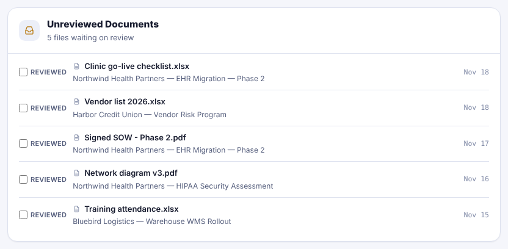

A running list of **every file a client has uploaded that hasn't been marked Reviewed**, newest first, across all engagements. Each row shows:

- a **Reviewed** checkbox,
- the file name,
- which client and engagement it belongs to,
- the day it was uploaded.

**Tick Reviewed** once you've looked at a file — it drops off the list immediately. This is the same checkbox you'll see next to the file inside the engagement drawer; ticking it in either place updates both. When everything is checked off, the panel shows a "caught up" message.

If the list is long, the panel scrolls on its own without moving the rest of the page.

> **Two different "reviewed" ideas** — don't mix them up:
> - **Per-file Reviewed checkbox** (here and in the drawer): tracks each individual document.
> - **Mark reviewed button** (in the drawer's portal section): clears the engagement-level "new documents" alert — the inbox badge, the drawer banner, and the Roundup's *New documents* line.
>
> They're independent: ticking every file doesn't clear the alert, and clearing the alert doesn't tick the files.

---

## 8. Toolbar: views, search, filters, zoom

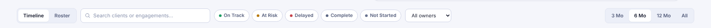

| Control | What it does |
|---|---|
| **Timeline / Roster** | Switches the main view between the Gantt chart ([section 9](#9-timeline-view)) and the client list ([section 10](#10-roster-view)). |
| **Search box** | Filters as you type. Matches engagement title, client name, owner, engagement type, **and custom field names and values** (so you can search a PO or contract number). |
| **Status chips** (On Track, At Risk, Delayed, Complete, Not Started) | Click one or more to show only engagements with those statuses. Click again to turn a chip off. With none selected, all statuses show. |
| **All owners** drop-down | Show only one person's engagements. |
| **3 Mo / 6 Mo / 12 Mo / All** | Timeline zoom — how many months the chart spans. **All** fits every engagement. (Only affects the Timeline view.) |

Search, chips and owner filter combine — e.g. *At Risk* + owner *Mike Torres* shows only Mike's at-risk work.

**Example — finding an engagement by its PO number:** typing `PO-48213` narrows the timeline down to the one engagement with that value in a custom field.

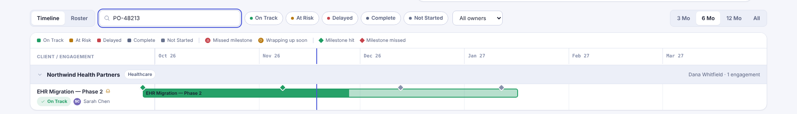

---

## 9. Timeline view

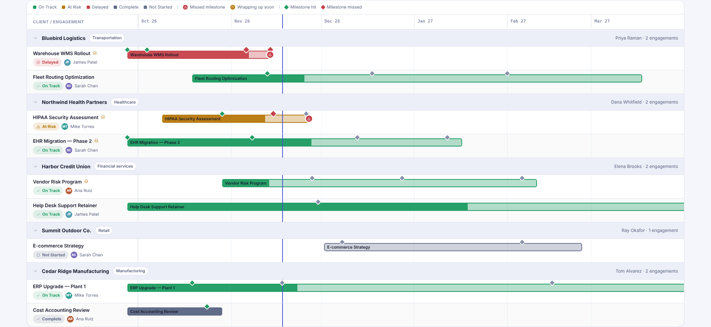

A Gantt chart of every engagement, grouped by client.

**Reading the chart**

- **Legend** (top strip) — explains every color and marker.
- **Month columns** across the top; the **vertical blue line** is today.
- **Client group rows** (shaded) show the client's name, industry tag, primary contact and number of engagements. Click a client row to **collapse or expand** its engagements.
- **Engagement rows** show, on the left, the title, a status badge and the owner (with a colored initials badge — each person always gets the same color). An **inbox icon** after the title means a client has uploaded new documents.
- **Bars** run from the start date to the target end date and are colored by status. The darker part of the bar is the **progress %** filled in so far.
- **Diamonds** are milestones: **green** = done, **red** = missed (past due and not done), **grey** = upcoming.
- A **red warning circle** at the end of a bar means missed milestones or past the end date; an **amber clock** means it wraps up within 14 days.

**Order on screen:** clients with at-risk or delayed work come first, then the rest sorted by nearest end date; completed work sinks to the bottom.

**Hover** over any bar or diamond for a tooltip with dates, owner, progress and any alerts:

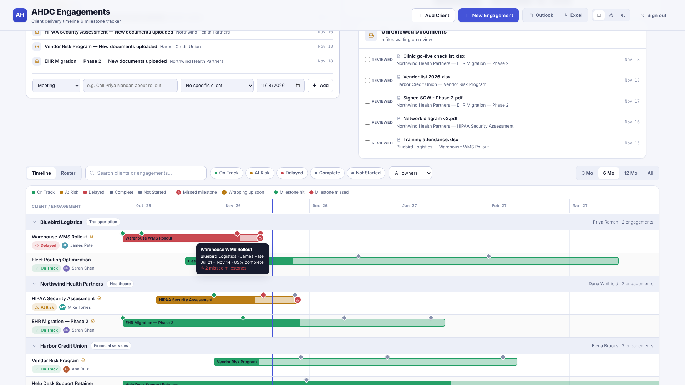

**Click** any bar or engagement name to open its [drawer](#11-the-engagement-drawer).

---

## 10. Roster view

Click **Roster** in the toolbar for a list of every client.

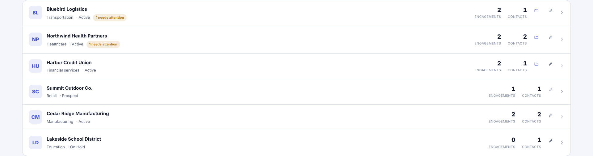

Each collapsed client card shows initials, name, industry, relationship status (Active / Prospect / On Hold), a **"needs attention"** tag if any of their engagements are at risk/delayed/overdue, counts of engagements and contacts, and on the right:

- **Folder icon** — opens the client's secure file location (only shown if one is set).
- **Pencil icon** — edit the client.
- **Arrow** — expand the card.

Click the card to expand it:

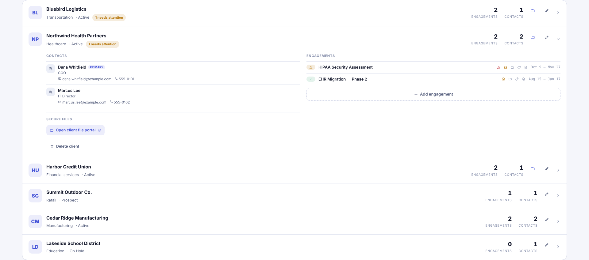

**Contacts** (left) — every contact with name, title and a **PRIMARY** tag on the main one. Click an **email** to start an email in Outlook (or your default mail app); click a **phone number** to call it on a device that can.

**Secure files** — **Open client file portal** opens the SharePoint/OneDrive link stored on the client.

**Engagements** (right) — one row per engagement with a status icon, the title, small badges (missed-milestone warning, new-documents inbox, linked-folder count, custom fields, notes) and the date range. Click a row to open its drawer. **+ Add engagement** starts a new engagement with this client already selected.

**Delete client** — see [Deleting things](#18-deleting-things).

---

## 11. The engagement drawer

Click any engagement (a timeline bar, a roster row, a Roundup item or a KPI list entry) and a panel slides in from the right. This is where most day-to-day updating happens. The engagement's [notes window](#12-the-floating-notes-window) also opens beside it.

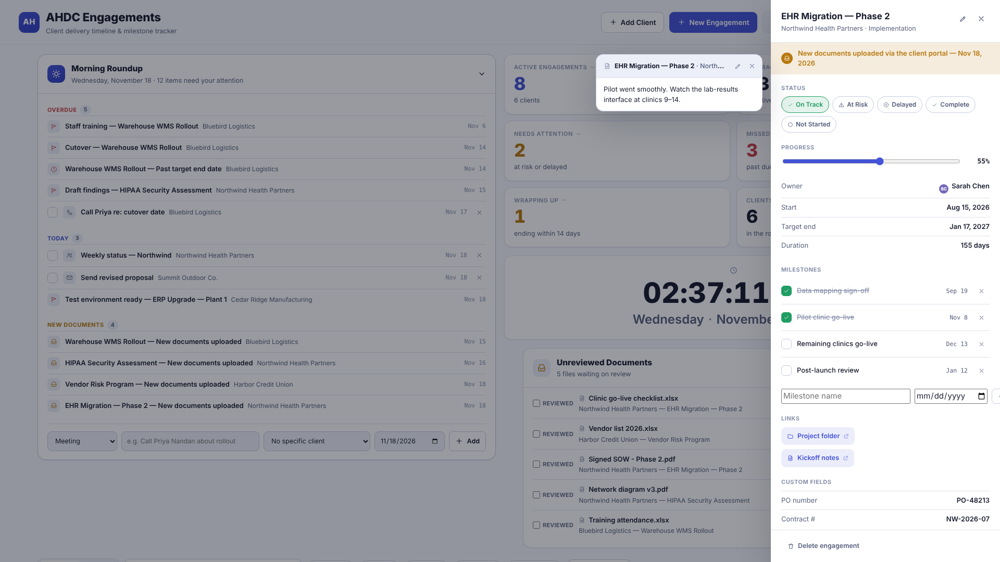

Close the drawer with the **×** at its top-right, by clicking the dimmed area to its left, or by pressing **Esc**. The **pencil** next to the × opens the full [Edit engagement](#14-adding-and-editing-an-engagement) form.

The drawer, top to bottom:

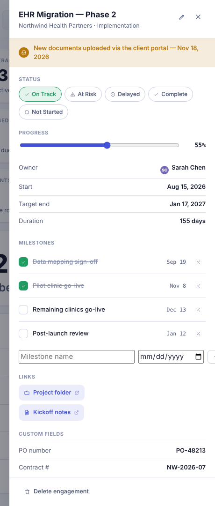

1. **Title and client** · engagement type.
2. **New documents banner** (amber) — only shown when a client has uploaded something you haven't cleared yet.
3. **Status** — click a pill (On Track, At Risk, Delayed, Complete, Not Started) to change it immediately.
4. **Progress** — drag the slider; the % updates the timeline bar as you go.
5. **Owner, Start, Target end, Duration** — read-only summary (change them with the pencil).
6. **Milestones** — tick the box to mark one done (it's struck through), click **×** to delete it. To add one: type a name and date in the empty row underneath and click **+** (or press Enter).

7. **Links** — every shared folder/page saved on this engagement. Click one to open it in a new tab. The icon is chosen automatically: notebook for OneNote, folder for SharePoint/OneDrive, arrow for anything else.
8. **Custom fields** — any extra name/value pairs (PO number, contract #, etc.).
9. **Notes** — the engagement notes. The small ↗ icon pops them out into the floating notes window.

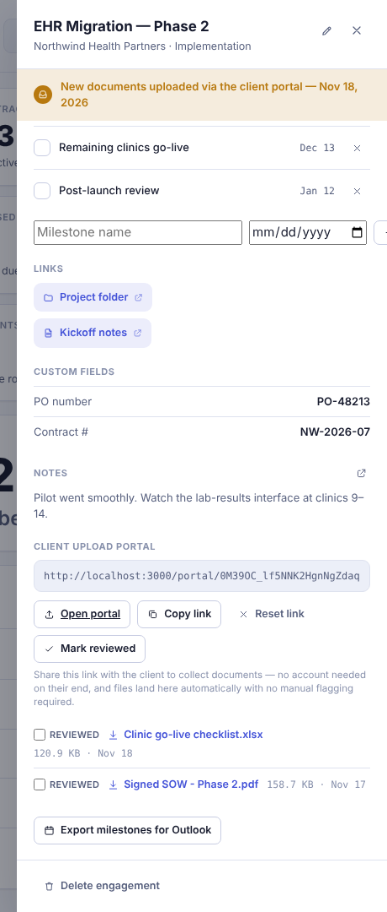

10. **Client upload portal** — the engagement's personal upload link for the client (see [section 15](#15-the-client-upload-portal-what-your-client-sees)):
    - **Open portal** — opens the page your client sees, in a new tab.
    - **Copy link** — copies the link so you can paste it into an email to the client.
    - **Reset link** — creates a brand-new link and permanently disables the old one. You'll be asked to confirm. Use this if a link was sent to the wrong person or you want to stop uploads.
    - **Mark reviewed** — clears the engagement's "new documents" alert (banner, inbox badges, Roundup line).
    - **File list** — every file the client has sent, with its size and upload date. Click a file name to **download** it. Tick **Reviewed** on each file once you've looked at it (this also removes it from the [Unreviewed Documents](#7-unreviewed-documents) panel); untick it if it needs another look.
11. **Export milestones for Outlook** — downloads just this engagement's milestones as an Outlook calendar CSV.
12. **Delete engagement** — see [Deleting things](#18-deleting-things).

---

## 12. The floating notes window

The small window that opens next to the drawer (top-left of it) shows the engagement's notes so you can read them while working in the drawer.

- **Drag** it by its title bar to anywhere on the screen.
- **Pencil** — switch to editing; type, then **Save notes** (or **Cancel**).
- **×** — close it. Reopen from the ↗ icon in the drawer's Notes section, or from the notes badge on a roster row.

Notes have no length limit.

---

## 13. Adding and editing a client

Click **+ Add Client** in the header. To edit an existing client, click the **pencil** on its roster card. It's the same form both ways.

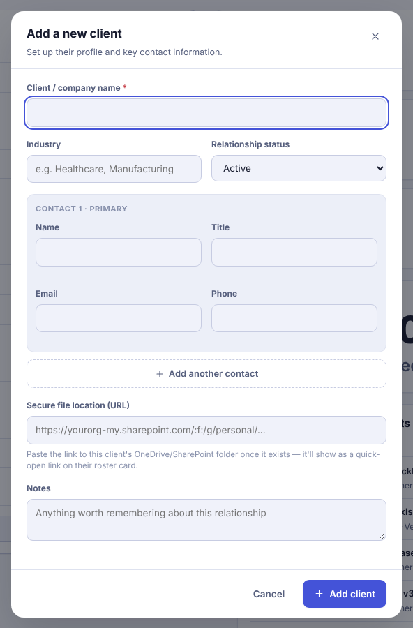

| Field | Notes |
|---|---|
| **Client / company name** * | Required. |
| **Industry** | Free text, e.g. Healthcare. Shows as a tag on the timeline. |
| **Relationship status** | Active, Prospect, or On Hold. |
| **Contacts** | Name, title, email, phone. **Contact 1 is the primary contact** (shown on the timeline and in exports). Click **+ Add another contact** for more; the × on a contact removes it. |
| **Secure file location (URL)** | Paste the link to the client's SharePoint/OneDrive folder. Creates the folder shortcut on the roster card. |
| **Notes** | Anything worth remembering about the relationship. |

Click **Add client** (or **Save changes** when editing). **Cancel**, the ×, clicking outside the form, or **Esc** closes it without saving.

---

## 14. Adding and editing an engagement

Click **+ New Engagement** in the header (or **+ Add engagement** on a roster card to preselect that client).

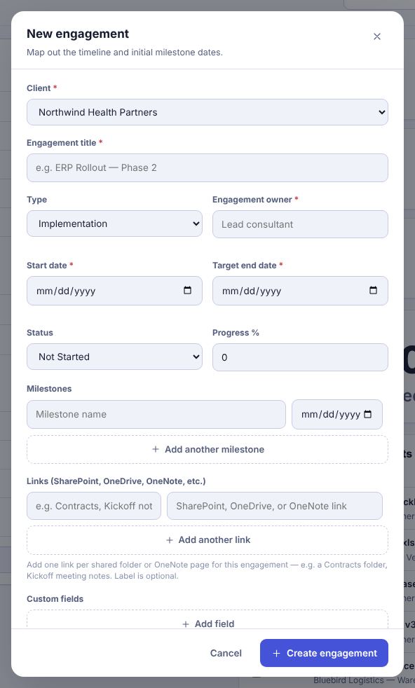

| Field | Notes |
|---|---|
| **Client** * | Which client this work is for. |
| **Engagement title** * | e.g. *ERP Rollout — Phase 2*. |
| **Type** | Implementation, Advisory, Audit & Compliance, Support & Maintenance, Strategy, or Custom. |
| **Engagement owner** * | The lead person. Type the name the same way each time so the owner filter and colors stay consistent. |
| **Start date** * / **Target end date** * | Define the bar on the timeline. |
| **Status** | Starts as Not Started; change any time from the drawer. |
| **Progress %** | 0–100. |
| **Milestones** | (New engagements only.) Name + date for each; **+ Add another milestone** for more. Later, milestones are managed in the drawer. |
| **Links** | A label (optional) and URL for each shared folder or OneNote page. **+ Add another link** for more. |
| **Custom fields** | **+ Add field** adds a name/value pair — e.g. *PO number* / *PO-48213*. As many as you like; × removes one. Values are searchable. |
| **Notes** | Free text. |

Click **Create engagement**. A client upload portal link is created for it automatically — nothing to set up.

**Editing:** open the drawer and click the **pencil**. The form shows the current values (scroll down for links, custom fields and notes) and **Save changes** applies them.

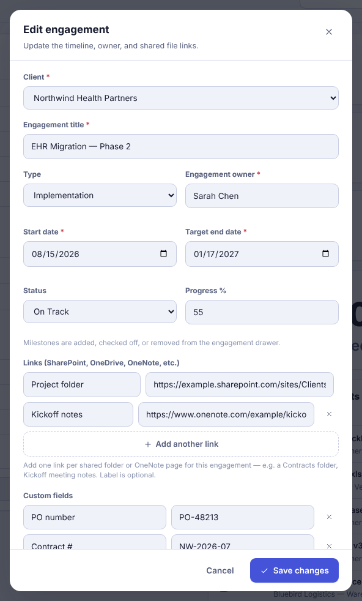
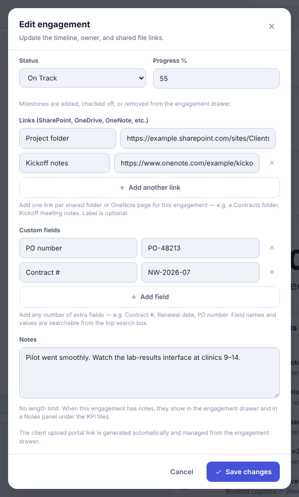

---

## 15. The client upload portal (what your client sees)

Every engagement has its own private upload page. Your client doesn't need an account or password — whoever has the link can upload to that one engagement, and nothing else.

**To collect documents from a client:**

1. Open the engagement's drawer and scroll to **Client upload portal**.
2. Click **Copy link** and paste it into an email to your client.
3. The client opens the link and sees this:

   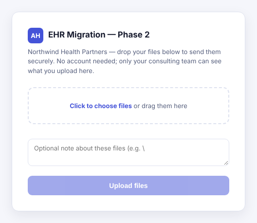

4. They click **Click to choose files** (or drag files onto the box), optionally add a note, and click **Upload files**.

   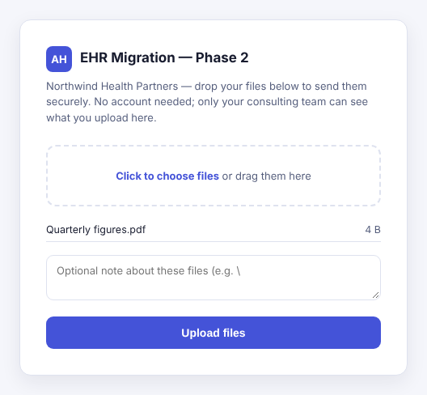

5. The moment the upload finishes, the dashboard shows it: an inbox badge on the engagement, a line in the Morning Roundup's **New documents** section, a banner in the drawer, and the file(s) in **Unreviewed Documents**.
6. Download and review the file from the drawer, tick **Reviewed**, and click **Mark reviewed** to clear the alert.

**Limits** (set by the server — see `.env.example`):

- Up to **25 MB per file** and **10 files per upload** by default.
- Program and script files are refused: `.exe .bat .cmd .sh .msi .com .scr .js .vbs .ps1 .jar .app`.
- Uploads are rate-limited (40 requests per 15 minutes per connection) to prevent abuse.

**If a link was reset**, anyone using the old one sees this instead of the upload page:

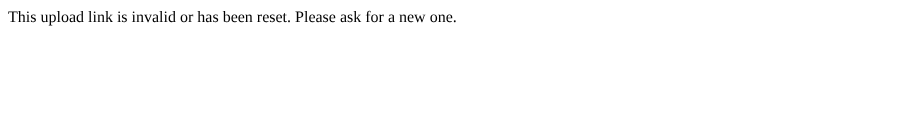

The client can't see other clients, other engagements, or previously uploaded files — only the upload form for that one engagement.

---

## 16. Exporting to Outlook and Excel

No Microsoft account connection is needed — both exports are ordinary CSV files downloaded by your browser.

**Outlook (milestones → calendar)**

1. Click **Outlook** in the header (all milestones) or **Export milestones for Outlook** in a drawer (just that engagement). A file named `ahdc-milestones-outlook.csv` downloads.
2. In Outlook (classic desktop version): **File → Open & Export → Import/Export → Import from another program or file → Comma Separated Values**, choose the file, and pick your **Calendar** as the destination.
3. Each milestone becomes an all-day event titled *Client — Engagement: Milestone*, with the owner and status in the description.

**Excel (everything)**

1. Click **Excel** in the header. A file named `ahdc-engagements-excel.csv` downloads.
2. Open it in Excel. You get one row per engagement (clients without engagements get one row too), with columns for client, industry, status, secure files link, primary contact details, engagement title, type, owner, dates, status, progress, milestones remaining, the engagement's upload portal link, and when new documents last arrived.

---

## 17. Light, dark and system themes

The three icons near the right of the header pick the color scheme:

- **Monitor** — follow your computer's light/dark setting (default).
- **Sun** — always light.
- **Moon** — always dark (handy for a wall display in a dim room).

The choice is remembered by each browser separately.

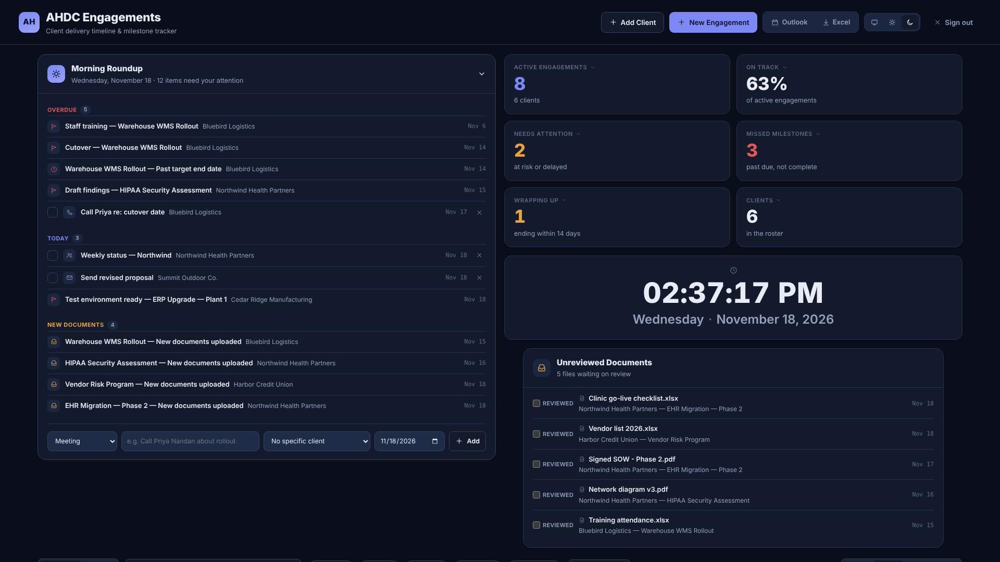

---

## 18. Deleting things

Deletes are permanent, so the dashboard asks twice:

- **Engagement:** in the drawer, click **Delete engagement** — the button turns red and reads **Confirm delete**. Click it again to delete. Closing the drawer cancels.
- **Client:** in an expanded roster card, click **Delete client**, then **Confirm delete client**. This also deletes all of that client's engagements.
- **Milestone:** the **×** next to it in the drawer removes it straight away.
- **To-do item:** the **×** on its Roundup row removes it straight away.

> Uploaded files on the server aren't removed when an engagement is deleted, and nightly backups (if set up — see the deployment notes) keep 30 days of history, so an accidental delete can usually be recovered by whoever administers the server.

---

## 19. Keyboard shortcuts and small tips

- **Esc** closes, in order: an open form → the notes window → the drawer.
- **Enter** submits the sign-in box, the Roundup quick-add, and the add-milestone row.
- The dashboard is built for a large, always-on display — leave it open on a wall-mounted screen and it keeps the clock and Roundup current. (Refresh the page to pull in changes made from another computer.)
- If two people edit at the same moment from different computers, the last save wins. Refresh before making a big batch of edits if someone else may have been working.

---

## 20. How statuses, colors and alerts are decided

| Thing | Rule |
|---|---|
| **Status** (On Track / At Risk / Delayed / Complete / Not Started) | Set by you — the dashboard never changes it on its own. |
| **Missed milestone** | Milestone date is before today and it isn't ticked. |
| **Past target end date** | End date is before today and the status isn't Complete. |
| **Wrapping up** | End date is today or within the next 14 days, and not Complete. |
| **Needs attention (KPI)** | Status is At Risk or Delayed. |
| **New documents** | Set automatically by the server when a client upload finishes; cleared by **Mark reviewed**. |
| **Owner colors** | Each owner name gets a fixed color worked out from the name, so the same person is always the same color. |

---

## 21. Troubleshooting

| Problem | What to do |
|---|---|
| "Could not save that change" / "Could not reach the server" | Check your internet connection and refresh the page. If it persists, the server may be down — see "Checking the server" in the [deployment notes](DEPLOYMENT.md). |
| Sent back to the sign-in page unexpectedly | Your 14-day sign-in expired, or the server was restarted with a new session secret. Sign in again. |
| Client says the upload link doesn't work | The link was probably reset. Copy the current link from the drawer and resend it. |
| Client's upload is rejected | File over 25 MB, more than 10 files at once, or a blocked file type. Ask them to zip a program file, split large uploads, or use your SharePoint folder for very large files. |
| An Outlook export does nothing | That engagement (or the whole dashboard) has no milestones yet. |
| Copy link didn't copy | Some browsers block clipboard access — click into the link box, select it and copy manually. |
